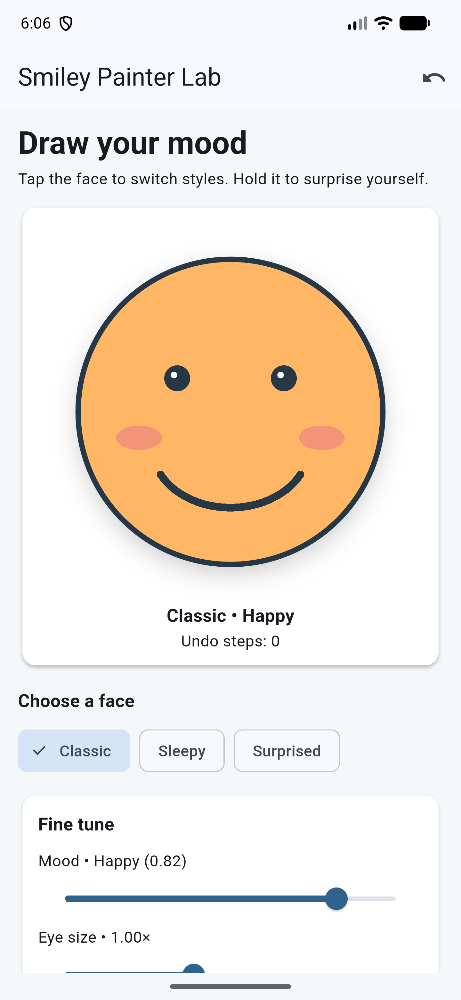
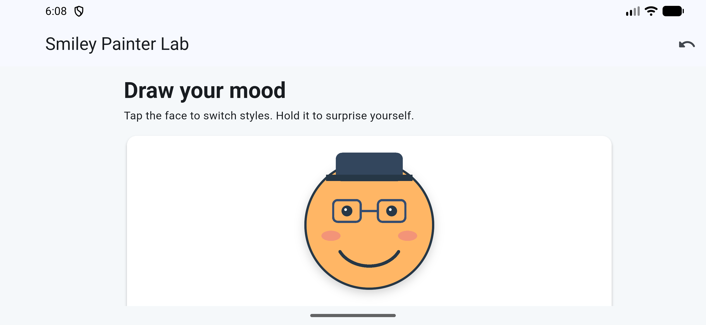

# Critical thinking: measuring the smile arc

Myles Miller | In-Class Activity 06 | September 29, 2026

I centered the face at `Offset(size.width / 2, size.height / 2)` and set its radius to `size.shortestSide * .40`; the classic mouth uses a centered `Rect` positioned `.23 * radius` below that center, with width `1.03 * radius` and height `(.32 + mood * .58) * radius`. Its `drawArc` starts at `.15 * pi` and sweeps `.70 * pi`, which gave me a balanced smile on the Pixel 7 Pro emulator; dragging mood to 0.12 changed it to a frown and a cool blue face. Instead of a fixed 300-pixel drawing stage, I sized `CustomPaint` from the available screen width and height, and the phone screenshots show the whole circular face in portrait and a smaller, still circular face in landscape without overflow. After a hot reload, dragging mood from 0.88 to 0.54 still updated the mouth and face color immediately. `shouldRepaint` returns true when mood or another visual input changes because the old pixels are then out of date, and false for identical painter inputs because those pixels can be reused.

**Phone-emulator evidence:** [portrait smile](images/portrait-classic.png) · [low mood](images/portrait-low-mood.png) · [landscape](images/landscape-smiley.png) · [after hot reload](images/after-hot-reload-slider.png)

